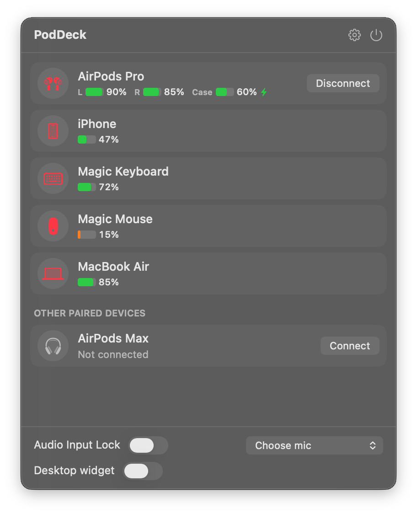
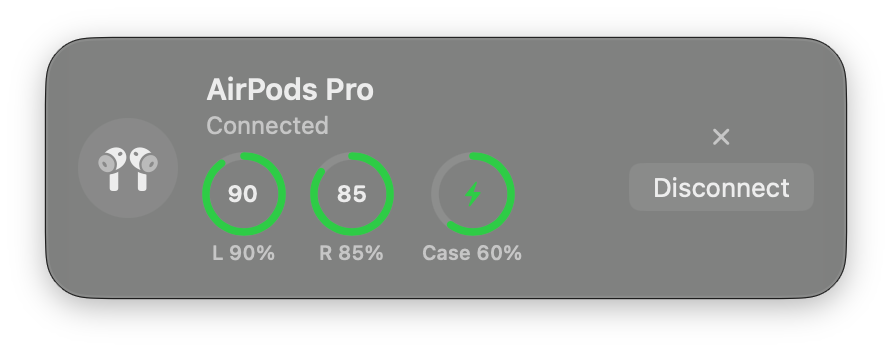
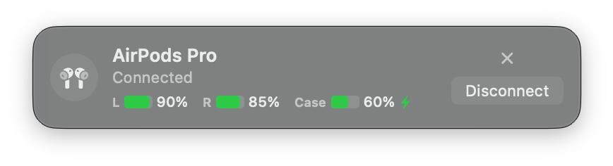
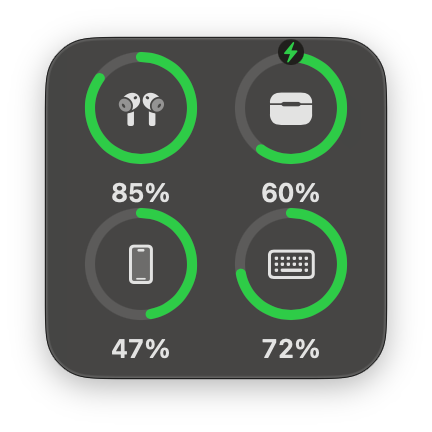
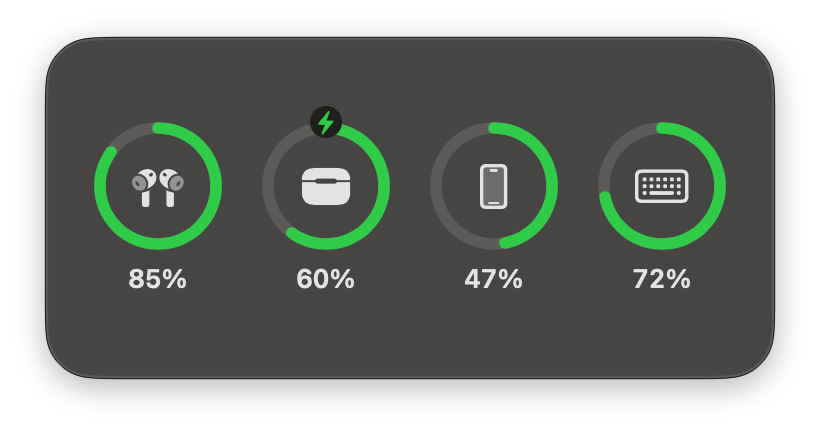
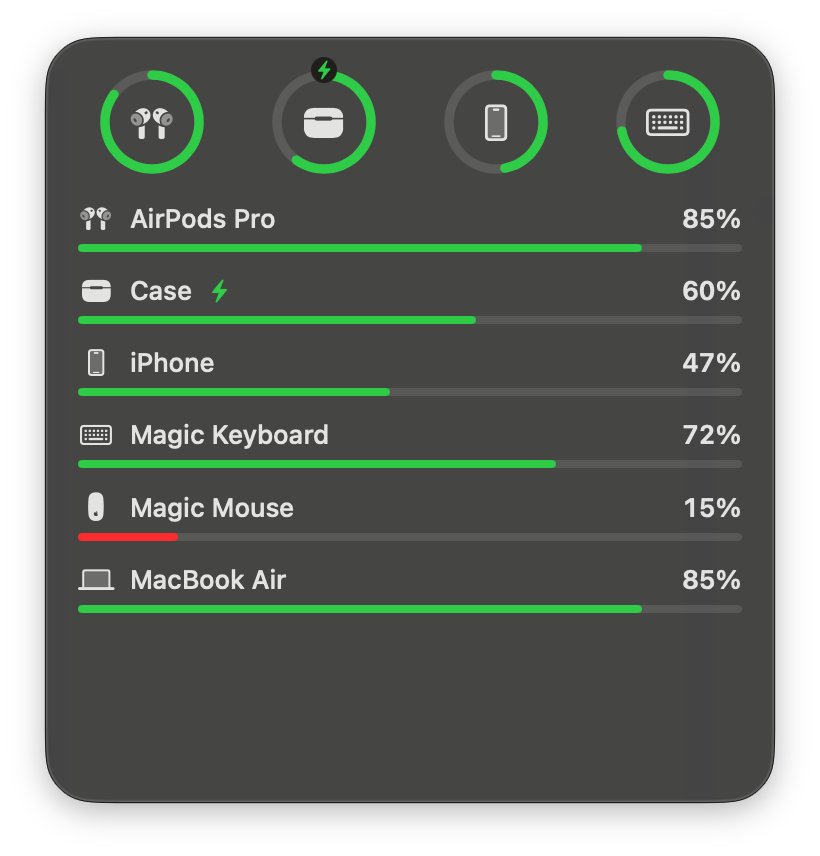

# PodDeck

A menu bar companion for AirPods, Beats and Apple accessories on macOS.

## Screenshots

<p>
  
</p>

**HUD** (large and compact)

<p>
  
  
</p>

**Desktop widget** (small, medium and large)

<p>
  
  
  
</p>

## Features

- **Dashboard** in the menu bar: every paired device with battery levels (left, right, case) and a Connect / Disconnect button. Right-click a device to pin it, mute its alerts or show it in the HUD.
- **Live AirPods and Beats batteries**, read from the headsets' Bluetooth LE broadcasts, with model detection for AirPods, AirPods Pro, AirPods Max and Beats.
- **Magic Mouse, Keyboard and Trackpad** batteries, plus this Mac's battery.
- **iPhone and iPad** batteries over USB or Wi-Fi sync (needs `brew install libimobiledevice` and "Show this iPhone when on Wi-Fi" in Finder).
- **HUD**: a pop-up at the top of the screen when your AirPods are nearby and not connected (with a Connect button), when a headset connects, or when a battery is low. Left, center or right; large or compact.
- **Battery alerts**: low-battery threshold, optional "fully charged" alert, per-device on/off, shown as a HUD, a notification or both.
- **Desktop widget** in the style of the macOS Batteries widget, in small, medium and large sizes. Drag it anywhere.
- **Audio Input Lock**: keeps the Mac on the microphone you choose, so connecting AirPods doesn't drop audio quality.
- **Menu bar percentage** for the connected headset, an option to hide the menu bar icon (open the app again to bring it back), and **launch at login**.

## Build

Needs only the Command Line Tools (no Xcode). macOS 14 or later.

```sh
./build.sh            # builds build/PodDeck.app
./build.sh --install  # builds, copies to /Applications and opens it
build/PodDeck.app/Contents/MacOS/PodDeck --dump   # print detected devices
```

The first launch asks for Bluetooth access.

## License

MIT © 2026 adamly218
